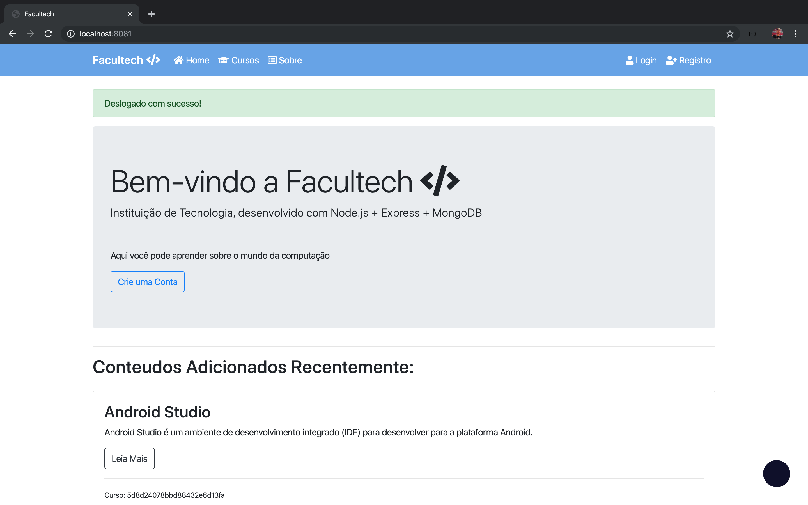
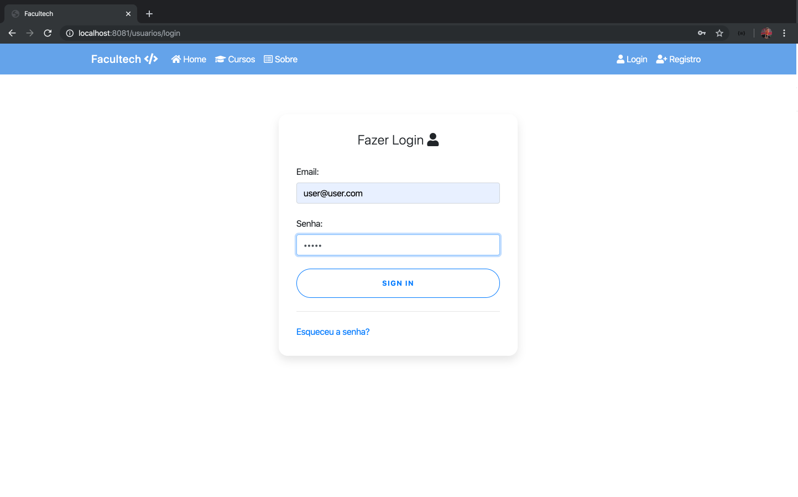
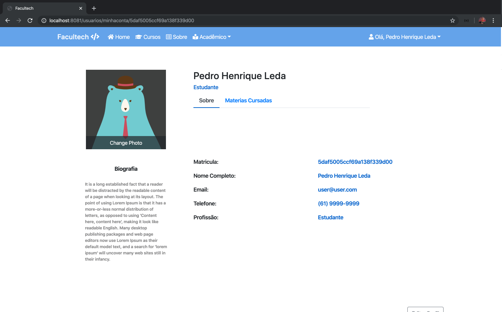
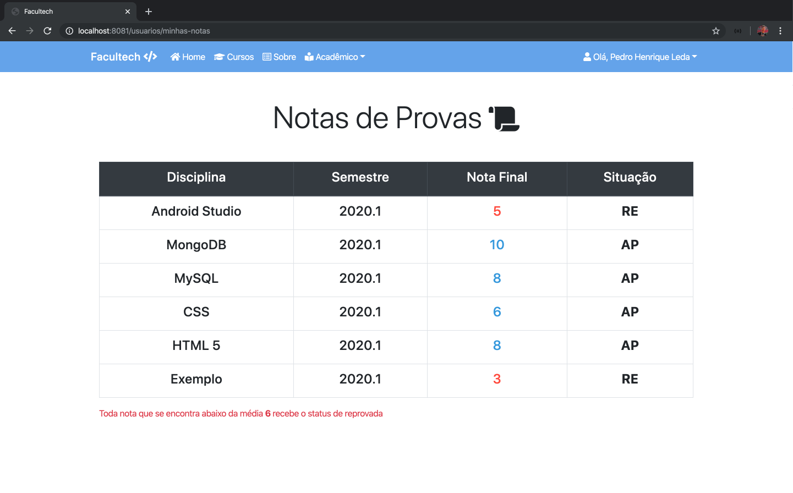
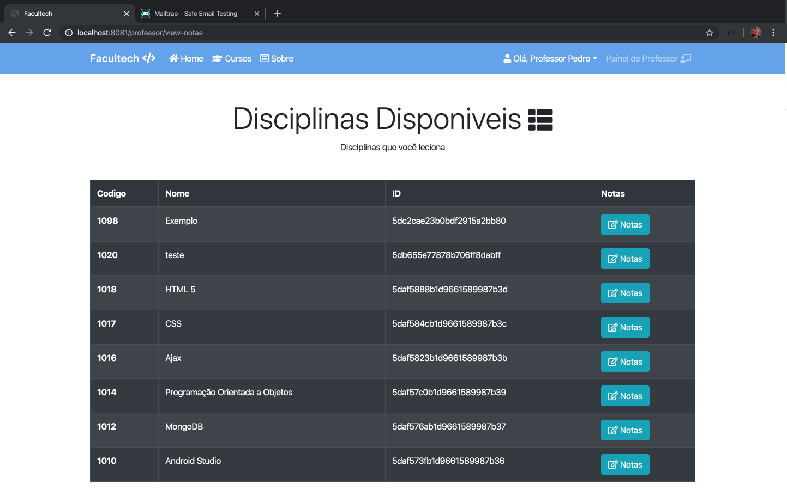
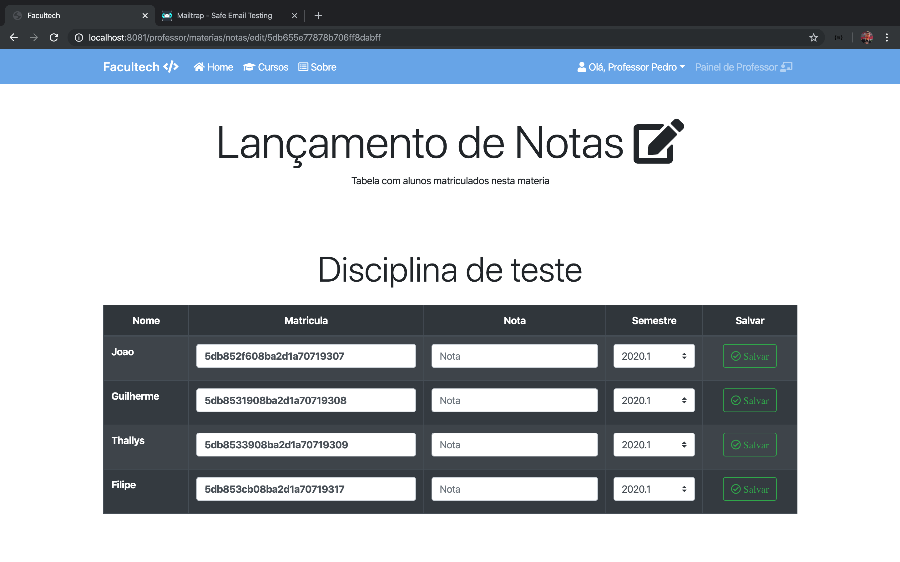

# Facultech

A college management prototype: students, professors and admins sharing one web app for
courses, subjects, enrollment and grades.

Built with Node.js, Express, Handlebars and MongoDB as a study project.



## Features

- **Three roles.** Students, professors and admins, each with their own pages. Passwords are
  hashed with bcrypt and every admin or professor route checks the logged-in user.
- **Courses and subjects.** Admins create, edit and delete courses and the subjects inside
  them, and enroll students in subjects.
- **Grades.** Professors post grades per subject and semester; students see their own report.
- **Posts.** Professors publish announcements shown on the home page.
- **Password reset** by email with a one-hour token.

## Getting started

You need Node.js 22+ and a MongoDB server. The quickest way to get MongoDB is Docker:

```bash
docker run -d --name facultech-mongo -p 27017:27017 mongo:8
```

Then:

```bash
git clone https://github.com/pedrinholeda/sistema-faculdade.git
cd sistema-faculdade
npm ci
cp .env.example .env   # then set SESSION_SECRET
npm run dev
```

Open http://localhost:8081. Every setting (port, MongoDB URI, SMTP) is listed in
[`.env.example`](.env.example).

### Creating the first admin

Sign up through the app, then promote that account in MongoDB:

```bash
docker exec -it facultech-mongo mongosh sistema-faculdade \
  --eval 'db.usuarios.updateOne({ email: "you@example.com" }, { $set: { eAdmin: 1 } })'
```

Log out and back in. The **Administrador** menu appears, and from there you can register
other admins and professors.

## Tests

```bash
npm test
```

Runs unit tests and an end-to-end flow (sign-up, login, admin access, course creation)
against an in-memory MongoDB, so no database setup is needed. CI runs the same command on
every pull request.

## Screenshots

| Login | Profile | Grades |
|---|---|---|
|  |  |  |

| Subjects (professor) | Posting grades (professor) |
|---|---|
|  |  |

## Project layout

```
app.js            Express setup and public routes
config/           passport strategy and environment settings
helpers/          route guards (eAdmin, eProfessor) and menu flags
models/           Mongoose schemas
routes/           admin, professor and user routes
views/            Handlebars templates
test/             node:test suites
```

## Status

Finished as a study prototype. It is not production-ready: there is no CSRF protection and no
rate limiting on login.
